<p align="center">
  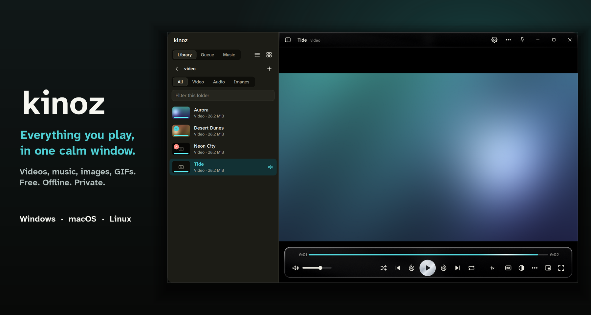
</p>

<h1 align="center">kinoz</h1>
<p align="center"><b>Everything you play, in one calm window.</b><br>A free, open-source, offline media player for videos, music, images and GIFs. Windows, macOS and Linux.</p>

<p align="center">
  <a href="https://github.com/p4inz-code/kinoz/releases/latest"></a>
  <a href="https://github.com/p4inz-code/kinoz/issues/new/choose"></a>
  <a href="https://discord.gg/8UKt8s5FbW"></a>
</p>

<p align="center">
  <a href="https://github.com/p4inz-code/kinoz/releases/latest"></a>
  <a href="https://github.com/p4inz-code/kinoz/releases"></a>
  <a href="https://github.com/p4inz-code/kinoz/stargazers"></a>
  <a href="LICENSE"></a>
</p>

<p align="center"></p>

kinoz is a media player for what's already on your computer: films in one folder, music in another, GIFs and screenshots somewhere else. It plays all of it in one window, so you don't need a video player, a music app and an image viewer.

It plays almost anything without codec packs, because the engine underneath is libmpv and FFmpeg. The interface is drawn by kinoz itself, so there's no OS title bar, no OS menus and no OS dialogs, and it looks the same on Windows, macOS and Linux. There's a light and a dark theme, and a switch that turns every animation off. No account, no cloud, no telemetry.

The thing I care about most is speed when you click around. Click through a folder or hammer Next and only the last file opens. In the benchmark, 150 rapid clicks opened 2 files and the interface never froze for more than 25 ms. A file shows its picture about 0.3 seconds after you click it.

## Get kinoz

Take the file for your system from the [latest release](https://github.com/p4inz-code/kinoz/releases/latest). Each one has a `.sha256` file next to it.

- Windows 11 (10 should work): `kinoz-Setup-<version>.exe`. Run it. It installs for your user only, needs no administrator rights, and picks a drive other than `C:` by default.
- macOS on Apple Silicon: `kinoz-<version>-macos.dmg`. Open it and drag kinoz to Applications.
- Linux on x86-64: `kinoz-<version>-x86_64.AppImage`. Run `chmod +x` on it, then run it.

> **Status: 0.2, usable every day on Windows.** Windows is the one I test hardest, with an automated self-test of 114 checks and a speed benchmark. The macOS and Linux builds come from CI, which builds them and runs a smoke test, but I haven't used them on real machines yet, so expect rough edges there. What's missing is listed in [Known issues](docs/KNOWN_ISSUES.md) and the [roadmap](ROADMAP.md).
>
> If you're on macOS or Linux, you're the testers. [Open a test report](https://github.com/p4inz-code/kinoz/issues/new?template=platform_test.md) and tell me what worked and what didn't: moving and resizing the window, fullscreen, media keys, opening your files.

<table>
<tr>
<td width="50%" align="center">
<sub>Dark theme</sub><br><br>
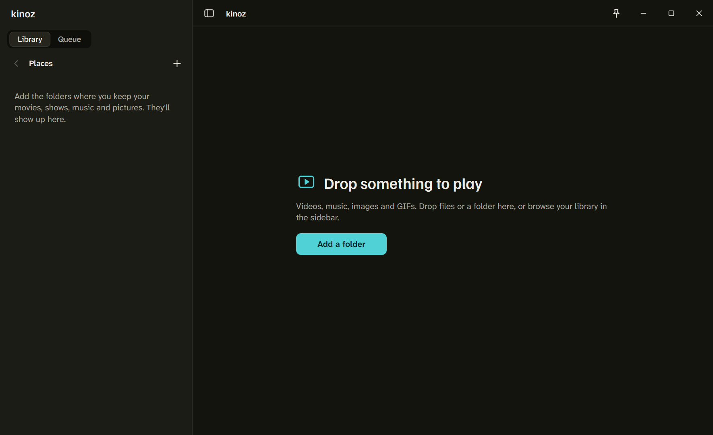
</td>
<td width="50%" align="center">
<sub>Keep and reject marks, watched progress</sub><br><br>
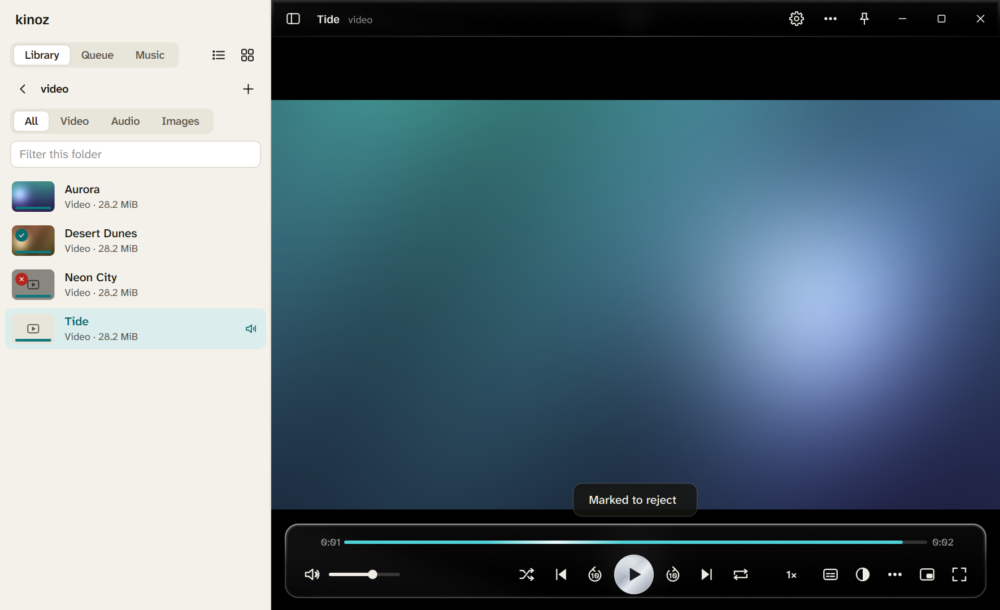
</td>
</tr>
<tr>
<td width="50%" align="center">
<sub>Music: artists, albums, songs, playlists</sub><br><br>
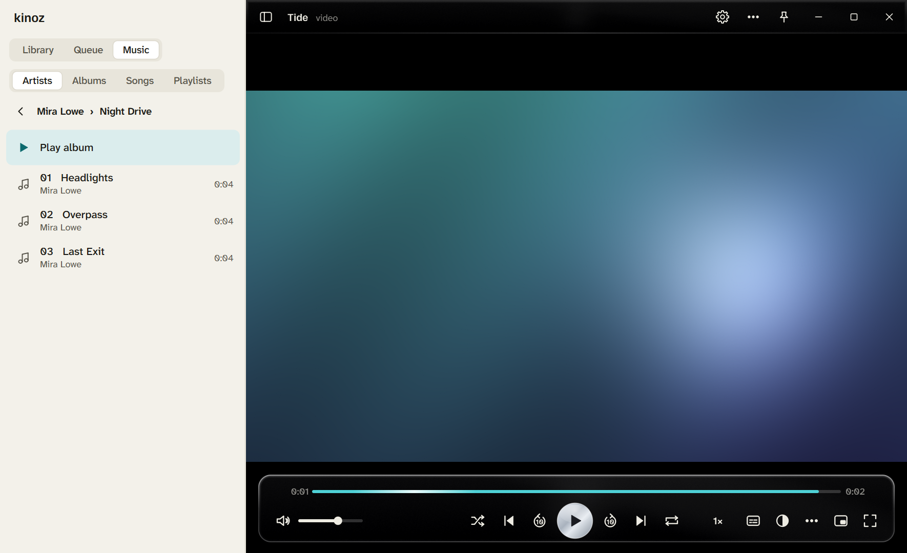
</td>
<td width="50%" align="center">
<sub>Light theme (<code>Ctrl+D</code> switches, no restart)</sub><br><br>
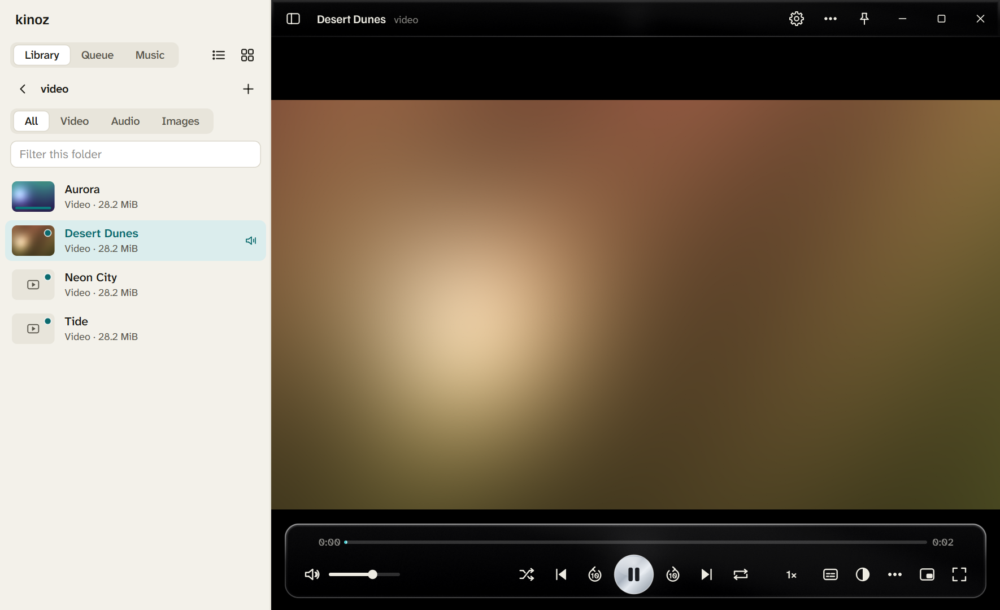
</td>
</tr>
</table>

<details>
<summary>More screenshots: playlists, queue, setup, command palette, Settings, Privacy, About</summary>
<br>

<p align="center">
  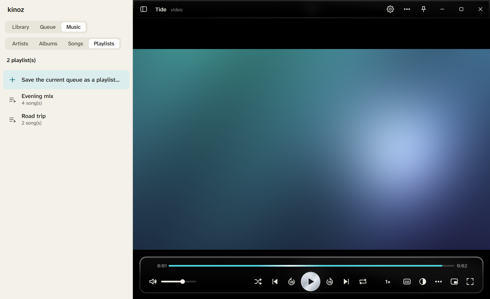
  <br><sub>Saved playlists are plain <code>.m3u8</code> files in the data folder. Save the queue from the Queue tab or <code>Ctrl+K</code>.</sub>
</p>

<p align="center">
  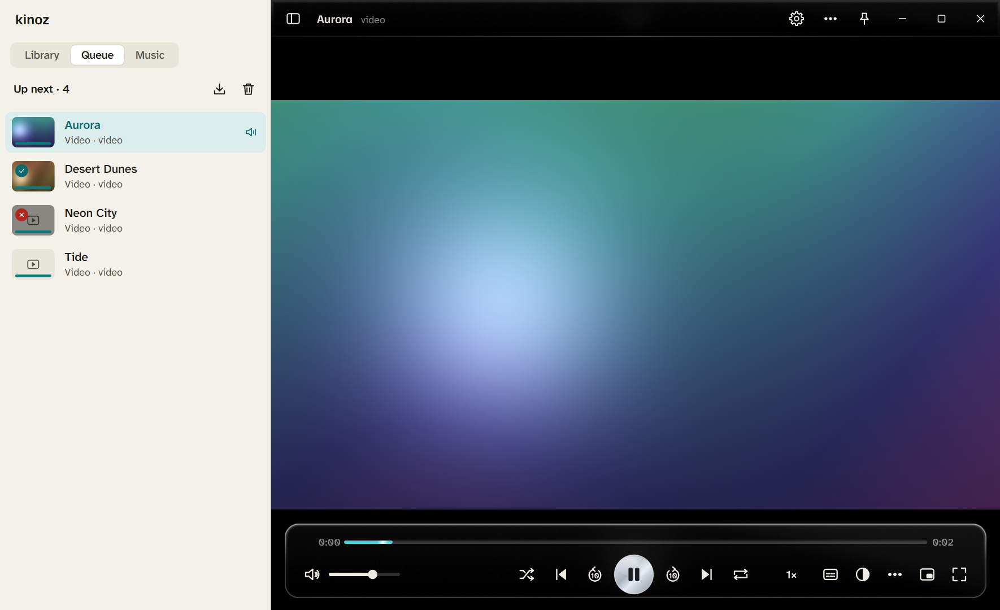
  <br><sub>The queue. Drag to reorder, save it as a playlist, or clear it.</sub>
</p>

<p align="center">
  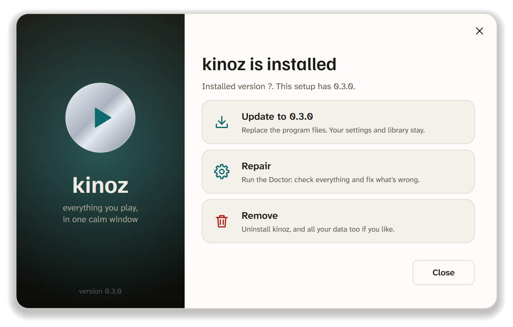
  <br><sub>The Windows setup is drawn by kinoz itself. It can install, update, repair (the Doctor) and remove, with an optional switch to delete all your data.</sub>
</p>

<p align="center">
  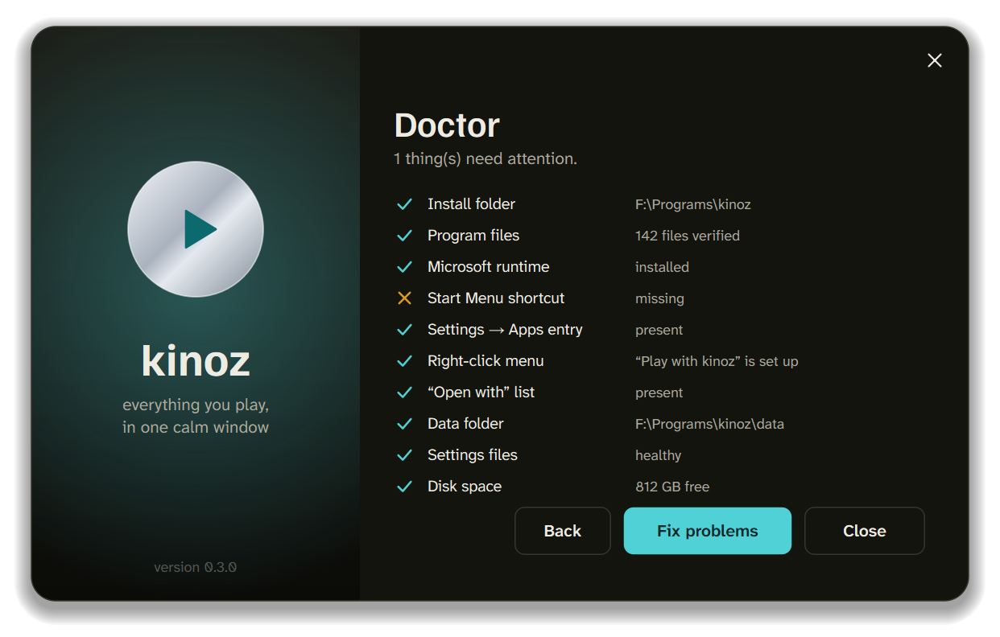
  <br><sub>The Doctor checks files, shortcuts, right-click entries, settings and disk space, and fixes what it can.</sub>
</p>

<p align="center">
  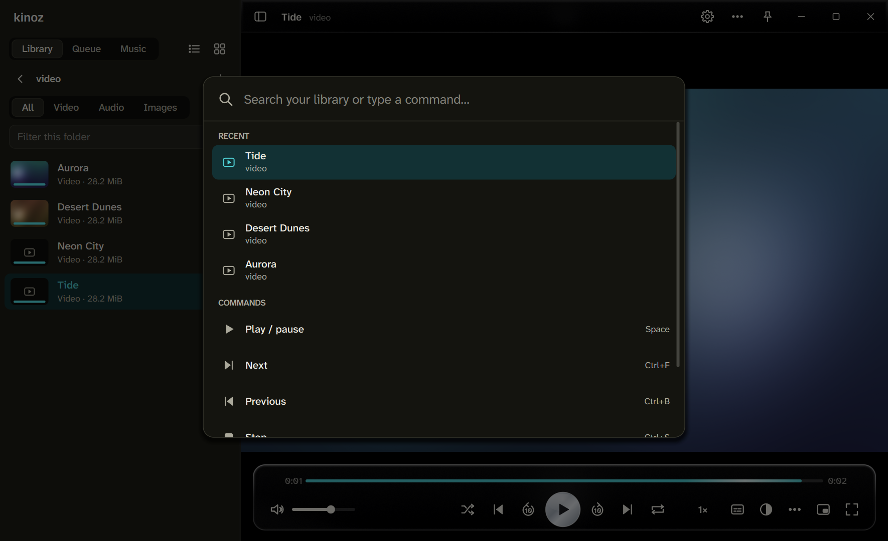
  <br><sub><code>Ctrl+K</code> searches your whole library and every command.</sub>
</p>

<p align="center">
  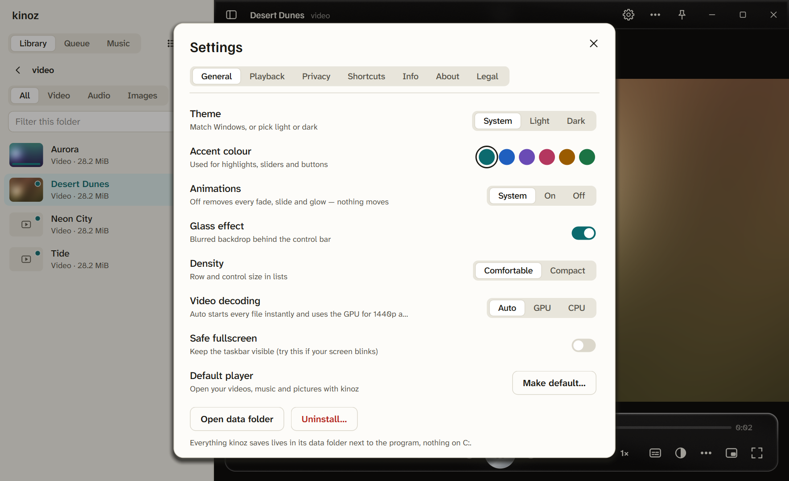
  <br><sub>Settings, General: theme, six accent colours, animations on or off, glass effect, density.</sub>
</p>

<p align="center">
  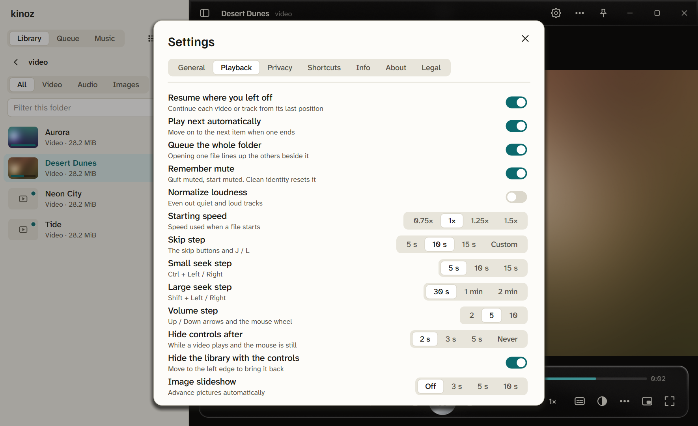
  <br><sub>Settings, Playback: resume, autoplay, starting speed, seek steps, volume step, how soon the controls fade, slideshow.</sub>
</p>

<p align="center">
  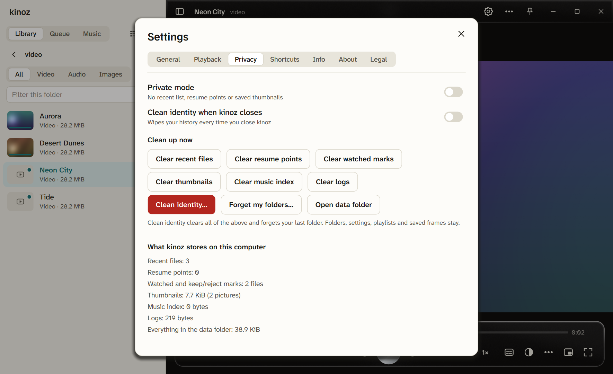
  <br><sub>Settings, Privacy: private mode, clean identity, a button for each kind of history, and a list of what kinoz stores and how much.</sub>
</p>

<p align="center">
  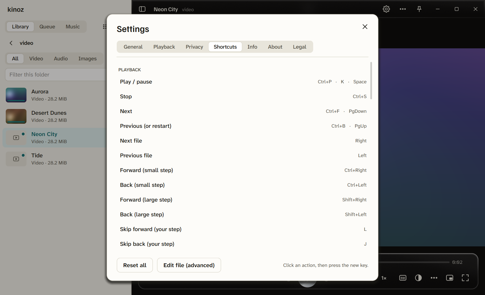
  <br><sub>Every keyboard shortcut and mouse action is listed, and you can add your own.</sub>
</p>

<p align="center">
  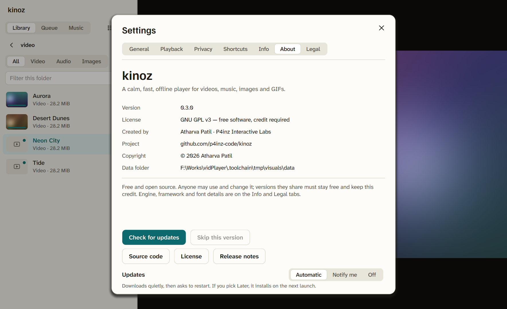
  <br><sub>About holds the version, license, credit and update settings.</sub>
</p>

</details>

<p align="center">
  <a href="#get-kinoz">Download</a> &nbsp;|&nbsp;
  <a href="#a-short-tour">Tour</a> &nbsp;|&nbsp;
  <a href="#making-kinoz-your-default-player">Default player</a> &nbsp;|&nbsp;
  <a href="#compared-with-the-default-apps">Compared with the defaults</a> &nbsp;|&nbsp;
  <a href="#what-you-get">What you get</a> &nbsp;|&nbsp;
  <a href="#keyboard-shortcuts">Shortcuts</a> &nbsp;|&nbsp;
  <a href="#faq">FAQ</a> &nbsp;|&nbsp;
  <a href="#troubleshooting">Troubleshooting</a> &nbsp;|&nbsp;
  <a href="#build-from-source">Build from source</a>
</p>

<p align="center"></p>

## A short tour

Press the **+** in the sidebar and pick the folder where your media lives. Thumbnails appear. Click a file to play it, and click through the list as fast as you like. Hover the seek bar to see the frame you're about to jump to.

When you're sorting through a folder, `Y` keeps a file, `N` marks it to reject, and `U` jumps to the next one you haven't seen. `Delete` moves the current file to the Recycle Bin, and it asks first. Once you've marked a pile, `Ctrl+K` and "Delete all rejected files" clears it.

While a video plays, the controls and the library fade away after two seconds, so the picture gets the whole window like in the Windows 11 player. Move the mouse to bring the controls back, or touch the left edge for the library. Settings (the gear) and the **⋯** menu are always in the top corner, even before you open anything.

`Ctrl+K` also searches every file under your folders and every command. The **Music** tab shows artists, albums and songs read from your files' tags, and the **Queue** tab can save what's playing as a playlist. `Ctrl+D` flips between light and dark, **Settings → Animations → Off** stops all motion, and **Settings → General → Default player** makes kinoz open your files.

<p align="center"></p>

## Making kinoz your default player

No program can quietly take over your file types, and kinoz doesn't try. It does the part that's allowed and makes the rest one click.

On Windows, go to **Settings → General → Default player → Make default**, or press `Ctrl+K` and choose "Make kinoz my default player". kinoz registers itself and opens its page in Windows **Settings → Apps → Default apps**, where you pick it for video, music and pictures. The last page of the installer has the same button. On macOS, select a video in Finder, press `Cmd+I`, set **Open with** to kinoz and click **Change All**. On Linux, the same menu entry runs `xdg-mime` for the common video, audio and image types, and from an AppImage it first writes the small launcher entry a package would have installed. The empty start screen has a "Make kinoz your default" button too.

The Windows setup also adds "Play with kinoz" and "Open folder in kinoz" to the right-click menu, and kinoz to the "Open with" list. **Settings → General → Uninstall…** removes all of it.

<p align="center"></p>

## Compared with the default apps

Every system ships players for video, music and pictures. They're fine for the basics and strong at what the vendor sells: stores, cloud libraries, casting. kinoz is for your own files, played well, in one app that looks the same everywhere. These apps change between versions and distributions, so read this as a guide. [Corrections are welcome](https://github.com/p4inz-code/kinoz/issues/new/choose).

### Windows 11

Media Player replaced Groove Music and covers your music library, playlists and video. kinoz plays almost any file without extra codec downloads, adds the skim tools (keep, reject, next unseen), shows a frame preview on the seek bar, remembers where you stopped in each file, and needs no Microsoft account.

Movies & TV is video playback plus the Microsoft store. kinoz plays local files only, so there's no store or DRM video, but it opens MKV, AVI, WebM, FLAC and similar files directly and adds an equalizer, picture adjust, A-B loop, frame step and frame annotation.

Photos handles pictures, albums and cloud sync. kinoz opens images and GIFs next to your videos with zoom, pan and a slideshow. It has no cloud sync and no photo editing. For grabbing a frame you might use Snipping Tool; kinoz saves any video frame at full resolution, or lets you draw on it first.

The Windows apps do better at syncing with a Microsoft account, store purchases and DRM streaming, casting, and CD ripping and burning.

### macOS

QuickTime Player plays and does simple recording of video and audio. kinoz opens formats QuickTime doesn't, for example many MKV and AVI files, with no converter. It has a library sidebar and a queue instead of one file at a time, plus playlists, speed with pitch correction and an equalizer.

Music is built around your Apple Music and iTunes library, and it handles local files and playlists too. kinoz works straight from your folders with no library import and no Apple account, reads artists, albums and songs from the files' tags, and plays your videos in the same app.

Preview and Photos handle images, PDFs and your photo library. kinoz browses a folder of pictures and GIFs with the arrow keys, with zoom, rotate and a slideshow, next to your videos.

The Mac apps do better at AirPlay and iCloud, Apple Music streaming, deep system integration and the Photos library. kinoz has Now Playing and media keys on macOS, but they haven't been tried on a real Mac yet.

### Linux (GNOME, KDE and others)

GNOME Videos (Showtime) and KDE's Dragon Player do simple video playback. kinoz adds a library sidebar, a queue, resume, skim tools, picture adjust, an equalizer and annotation, plays music and images in the same window, and looks the same on any desktop.

Rhythmbox and Elisa are music libraries. kinoz gives you artists, albums, songs and playlists from your folders in the same app as your videos, and saved playlists are plain `.m3u8` files.

Image viewers such as Eye of GNOME and Gwenview only show pictures. In kinoz, pictures and GIFs open in the same window as video and music.

The Linux apps do better at following your desktop theme exactly, at desktop integration and at being packaged by your distribution. kinoz has MPRIS (media keys and the desktop's now-playing card), but it hasn't been tried on a real desktop yet.

### What stays the same on all three

The built-in apps are fine with common files, but some formats need extensions, converters or store downloads. kinoz plays almost anything out of the box. Their libraries and history often live in a system or cloud service, while kinoz keeps plain files in its own folder. They update with the OS, and kinoz updates itself: it downloads in the background, then asks whether to restart now or later, and you can switch that off. And it's free, GPLv3, with no account and no telemetry.

kinoz doesn't do casting to TVs and speakers, CD and DVD features, streaming-service integration or cloud sync, and none of those are planned.

<p align="center"></p>

## What you get

kinoz opens MKV, MP4, AVI, WebM, HEVC, FLAC, MP3, JPG, PNG, WebP, GIF and many more, with SRT and ASS subtitles, and no codec packs. The library has your folders in a sidebar, thumbnails cached on disk, list or grid view, a type filter, search, sort, a queue, a resume position for each file and a list of recent items. `Ctrl+K` finds any file or command from the keyboard.

For skimming, click through files or spam Next and only the last one opens. In the benchmark that was 150 clicks, 2 files opened and no freeze longer than 25 ms. The next file is pre-read, the seek-bar preview comes from a strip built in the background so it never waits, and `1` to `9` jump to 10% to 90% of a video. Keep or reject files with `Y` and `N`, see what you've already watched, and delete the rejects to the Recycle Bin in one go.

Music has Artists, Albums, Songs and Playlists, read from your folders' tags once and cached. Saved playlists are plain `.m3u8` files, and `.m3u`, `.m3u8` and `.pls` files open as a queue. On Windows there's a now-playing card in the volume flyout and on the lock screen, with play, pause, next, previous and seeking. macOS (Now Playing) and Linux (MPRIS) have the same controls, still to be confirmed on real machines.

The playback tools are speed with pitch correction, frame step, A-B loop, a sleep timer, aspect ratio, audio and subtitle delay and track menus. For sound there's a 10-band equalizer with presets, a loudness normalizer and an output-device picker. For picture you get brightness, contrast, saturation, gamma and hue, live. Images and GIFs have zoom, pan, rotate, folder browsing with the arrow keys and an optional slideshow. You can draw on a paused frame or an image and export a full-resolution PNG or copy it.

There's fullscreen, a mini always-on-top player, several independent windows, and "Safe fullscreen" if your display blinks. The look has a light and dark theme, six accent colours, a glass effect, compact density, and animations set to System, On or Off. Settings has seven tabs: General, Playback, Privacy, Shortcuts, Info (system, graphics, engine, current file, copy diagnostics), About and Legal. Hover any icon for a second and a small label tells you its name and shortcut.

The setup is drawn by kinoz. It verifies its files, rolls back on failure, repairs with the Doctor, and removes everything (your data too, if you choose) with one switch. If kinoz ends abnormally twice, it starts in safe mode on its own. A broken or missing file is skipped with a clear message instead of stopping the queue, and kinoz only plays local files and runs no external tools or scripts. The only network request is the optional, SHA-256-verified update check.

<p align="center"></p>

## Supported file types

kinoz recognises these in the library and in "Open with". The engine can also play other formats you drop onto it.

- Video: `mp4` `m4v` `mkv` `avi` `webm` `mov` `wmv` `flv` `ts` `m2ts` `mts` `mpg` `mpeg` `3gp` `ogv` `vob` `divx` `f4v` `asf` `rm` `rmvb`
- Audio: `mp3` `flac` `wav` `ogg` `oga` `opus` `m4a` `aac` `wma` `aiff` `aif` `ape` `alac` `mka` `wv` `mpc` `dsf` `ac3` `dts`
- Images: `jpg` `jpeg` `png` `bmp` `tif` `tiff` `webp` `ico` `jfif`, plus `avif` `heic` `heif` `jxl` where the bundled FFmpeg supports them
- Animated: `gif` `apng`
- Subtitles: `srt` `ass` `ssa` `vtt` `sub`

<p align="center"></p>

## Keyboard shortcuts

The full list is in **Settings → Shortcuts**, where you can change any of them: click an action and press the new key. The ones to know:

| Key | Action | Key | Action |
|---|---|---|---|
| `Space` / `Ctrl+P` | Play / pause | `Ctrl+K` | Search and commands |
| `Left` / `Right` | Previous / next file | `F` / `Alt+Enter` | Fullscreen |
| `J` / `L` | Skip back / forward (5, 10, 15 s or your own number, same as the skip buttons) | `Ctrl+M` | Mini player |
| `Up` / `Down` | Volume | `Ctrl+N` | New window |
| `M` / `F7` | Mute | `Tab` | Show / hide the library |
| `]` / `[` | Faster / slower | `A` | Annotate this frame |
| `.` / `,` | Next / previous frame | `B` | A-B loop |
| `Ctrl+B` / `Ctrl+F` | Previous / next | `Ctrl+E` / `Ctrl+J` | Equalizer / adjust picture |
| `Ctrl+H` / `Ctrl+T` | Shuffle / repeat | `Ctrl+D` | Switch theme |
| `Ctrl+Shift+S` | Save this frame as an image | `Ctrl+,` | Settings |
| `1` ... `9` | Jump to 10% ... 90%, `0` to the start | `` ` `` | Show / hide the library (also `Tab`) |
| `Y` / `N` | Keep / mark to reject | `U` | Next file I haven't seen |
| `Delete` | Move this file to the Recycle Bin (asks first) | | |

On an image: mouse wheel or `=` / `-` zooms, drag pans, `R` rotates, `0` fits to the window.

<p align="center"></p>

## Updates and uninstall

Updating happens inside kinoz and takes one click, or none. About 8 seconds after you start it, kinoz checks GitHub, at most once a day (and again every few hours while it stays open). In **Automatic** mode, the default, a new version downloads in the background with a progress bar and is checked against its published SHA-256. Then kinoz asks **Restart now / Later**. If you pick Later, it installs by itself the next time you open kinoz. In **Notify me** mode you press **Update** yourself, and **Skip this version** quiets one release. If the connection drops, the download continues where it stopped, and if GitHub's API is rate limited kinoz reads the releases page instead. If anything fails, the message stays in the app with **Try again**; kinoz never sends you to a web page to fix it. The same works on all three systems: on Windows the new setup runs silently, on Linux the AppImage replaces itself (the old one stays next to it as `.previous`), and on macOS the app is swapped from the downloaded disk image. The Linux and macOS updaters are new and have not run on real machines yet. The release page on GitHub is still there if you would rather download by hand.

To uninstall on Windows, use **Settings → General → Uninstall…**, or press `Ctrl+K` and type "uninstall", or go to Windows **Settings → Apps → Installed apps → kinoz → Uninstall**. Leave **Delete all my data too** on to remove everything: settings, resume points, thumbnails, logs and exported frames. Your own media files are never touched. For a silent uninstall run `kinoz.exe --uninstall --silent --delete-data`. On macOS, drag kinoz out of Applications. On Linux, delete the AppImage.

The Windows setup also has a Doctor that checks an installation and repairs it. Run `kinoz.exe --doctor`, or use `Ctrl+K` and "Doctor". It checks the files, shortcuts and registry entries, and also that the playback engine starts, that secure connections work for updates, that your settings files are healthy (a damaged one is restored from the copy made at the previous start), leftover crash reports and half-finished update files, and whether GitHub can be reached. On macOS and Linux run `kinoz --doctor` for the same checks as text, and add `--fix` to repair the safe ones. `Ctrl+K` and "Health check" copies a report to the clipboard on every system. The last three runs keep their logs (`app.log`, `app.previous.log`, `app.previous2.log` in the logs folder), so a crash can still be explained after you reopen kinoz; `kinoz --debug` makes one run more talkative.

<p align="center"></p>

## FAQ

### Does it send anything about me?

No. There are no accounts, no analytics and no crash reports. The only network request kinoz can make is the optional update check to `github.com`, a plain request for the latest release. Turn it off under **Settings → About → Updates → Off**. Details are in [PRIVACY.md](PRIVACY.md).

### Where does it keep my settings?

In a `data` folder inside the install folder, so nothing is spread over `C:`. **Settings → General → Open data folder** opens it, and deleting a file there resets that part.

### Does it change or delete my media?

Never on its own. `Delete` moves the current file to the Recycle Bin and always asks first.

### Can I use it at work?

Yes. It's GPLv3, so it's free for any use. If you share a modified version, keep it GPLv3, keep the credit and give it a different name.

### Which formats does it play?

Almost anything FFmpeg opens. The common ones are listed [above](#supported-file-types), and you can drop other files onto it.

### Why does the Windows setup look different?

It's drawn by kinoz itself instead of the stock wizard. It has the same look as the app, a built-in Doctor and a one-click full uninstall.

### Can I add my own shortcuts?

Yes. Open **Settings → Shortcuts**, click an action, press the key you want, and it works at once. If another action already used that key, it moves and the page tells you. **Reset all** goes back to the defaults. The changes are stored in `keymap.json` for anyone who prefers a file.

<p align="center"></p>

## Troubleshooting

If the screen blinks or goes black when you go fullscreen, turn on **Settings → General → Safe fullscreen**. If playback is choppy or you see a graphics glitch, set **Settings → General → Video decoding** to CPU and reopen the file.

If kinoz closes unexpectedly twice in a row, it starts in safe mode by itself, with software decoding and no glass effect. You can change that back in Settings. If a file won't play, copy the details with **Settings → Info → Copy diagnostics** and [open an issue](https://github.com/p4inz-code/kinoz/issues/new/choose).

If something in the install looks broken, `kinoz.exe --doctor` on Windows checks files, shortcuts, right-click entries and settings, and fixes what it can. To start over, close kinoz and delete the `data` folder next to it, or use Uninstall with "Delete all my data too".

<p align="center"></p>

## Privacy

kinoz works fully offline. Settings, resume points, thumbnails and exports are stored in its data folder on your own computer, and nothing is sent anywhere. The only network request it can make is the optional update check to `github.com`, a plain request for the latest release with no user data, which you can turn off in **Settings → About**. Full details: [PRIVACY.md](PRIVACY.md).

kinoz saves history by default, so videos resume where you stopped. When you want less, **Settings → Privacy** has a Private mode (nothing about what you watch is written to disk), a "Forget on exit" switch, and a **Clean identity** button. Clean identity wipes recent files, resume points, marks, thumbnails, the music index and logs in one click, and keeps your settings, folders and playlists. Each kind of history also has its own clear button, and right-clicking a file gives you **Forget this file**. From a terminal, `kinoz --wipe` does the same as Clean identity.

## Build from source

Everything needed is in this repository. Qt and libmpv are downloaded by a script, not committed.

**Windows** (Visual Studio with the C++ workload):
```powershell
powershell -ExecutionPolicy Bypass -File scripts\setup-toolchain.ps1   # once: Qt 6.8, libmpv, Inno Setup into .toolchain\
scripts\build.ps1                                                      # builds to dist\app
scripts\release.ps1                                                    # builds + the installer
```

**macOS:** `brew install qt mpv pkg-config cmake`, then `cmake -B build -DCMAKE_PREFIX_PATH=$(brew --prefix qt) && cmake --build build`

**Linux:** `sudo apt install qt6-base-dev libgl-dev libmpv-dev pkg-config cmake`, then `cmake -B build && cmake --build build`

More in [CONTRIBUTING.md](CONTRIBUTING.md) and [docs/DEVELOPMENT.md](docs/DEVELOPMENT.md). A built-in self-test (`kinoz --selftest <file>`) drives every control and checks the result, and `kinoz --bench <video>` runs the speed benchmark.

## Documentation

[Known issues](docs/KNOWN_ISSUES.md) · [Testing on macOS and Linux](docs/TESTING.md) · [Changelog](CHANGELOG.md) · [History](docs/HISTORY.md) · [Maintaining](docs/MAINTAINING.md) · [Releasing](docs/RELEASING.md) · [Roadmap](ROADMAP.md) · [Architecture](docs/ARCHITECTURE.md) · [Design notes](docs/DESIGN.md) · [Performance notes](docs/PERFORMANCE.md) · [Privacy](PRIVACY.md) · [Security](SECURITY.md) · [Support](SUPPORT.md) · [Contributing](CONTRIBUTING.md)

## Support and feedback

- Bugs and ideas: [open an issue](../../issues/new/choose)
- Chat: [Discord](https://discord.gg/8UKt8s5FbW)
- Security problems: see [SECURITY.md](SECURITY.md) and report privately

## License and credit

kinoz is free software under the GNU General Public License v3 ([LICENSE](LICENSE)), with a few additional terms about credit and naming ([ADDITIONAL_TERMS.md](ADDITIONAL_TERMS.md)).

You can use it for anything, free of charge, including at work. You can study it, change it and share it, modified or not. If you share a version, you need to keep the author credit ("Created by Atharva Patil, P4inz Interactive Labs") and the copyright notices, keep the source open under the same GPLv3 license, and give a modified version its own name instead of "kinoz". Nobody can take it closed-source or sell it as their own work.

Every source file carries the copyright and `SPDX-License-Identifier: GPL-3.0-only` line, and the About screen shows the credit. Third-party components keep their own licenses: [THIRD_PARTY_NOTICES.md](THIRD_PARTY_NOTICES.md).

Copyright © 2026 Atharva Patil.

---

Built by [P4inz Interactive Labs](https://github.com/p4inz-code).

---

<!-- SUPPORT-BLOCK:START -->
<div align="center">

### Support my work

I make these tools on my own and keep them free. If one helped you, you can chip in by UPI. Any amount.

<a href="https://p4inz-code.github.io/donate/"></a>

`9321614988@jio`

On your phone? [Open the donation page](https://p4inz-code.github.io/donate/).

Outside India, or prefer a card?

<a href="https://buymeacoffee.com/p4inz"></a>

</div>
<!-- SUPPORT-BLOCK:END -->
